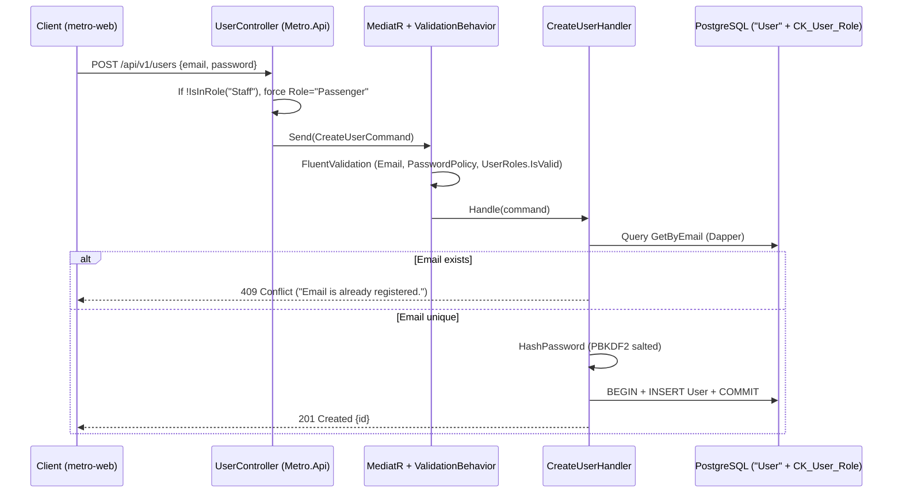

# Feature Design — `accounts-access` (`metro-core`)

- **Feature folder:** `.ai/sdd/specs/accounts-access/`
- **Traces to:** `FR-ACC-01`, `FR-ACC-02`, `FR-ACC-03`, `NFR-SEC-01`, `NFR-SEC-02`, `ADR-003`

## 1. Architecture and Component Responsibilities

Follows Clean Architecture + CQRS (`.ai/steering/conventions.md`, `.ai/steering/principles.md`):

- **Domain (`Metro.Domain`):**
  - `Users/UserRoles.cs`: canonical role constants (`Passenger`, `Staff`), `IsValid(string?)`, and `ValidationMessage`.
  - `Users/Entities/User.cs`: aggregate root holding `Email`, salted `Password`, `Role`, `IsActive`, and optional profile metadata.
  - `Auth/PasswordPolicy.cs`: password strength predicate + English `RequirementsMessage`.
- **Application (`Metro.Application`):**
  - `Users/Commands/{Create,Update,Delete}UserCommand.cs`: default `Role = UserRoles.Passenger`; optional `Name`/`Document`/`Phone` (default `string.Empty`) so minimal `FR-ACC-01` registration works.
  - `Users/Validators/*Validator.cs` & `Auth/Validators/*Validator.cs`: FluentValidation rules executed via MediatR `ValidationBehavior`, returning English messages.
  - `Users/Handlers/*Handler.cs` & `Auth/Handlers/*Handler.cs`: transactional writes via `IUnityOfWork` + `IUserRepository`; duplicate email check via Dapper `IUserQueryRepository`.
- **Infrastructure (`Metro.Infrastructure.PostgreSQL` & `Metro.Infrastructure.Auth`):**
  - `Mappings/User/UserMap.cs`: unique index on `Email` and PostgreSQL check constraint `CK_User_Role ("Role" IN ('Passenger', 'Staff'))`.
  - `Migrations/20261124120000_CanonicalUserRoles.cs`: idempotently updates legacy role values (`master/admin -> Staff`, `client/user -> Passenger`) and applies `CK_User_Role`.
  - `Initializers/PostgreSQLInitializer.cs`: `SeedStaffUser` creates optional initial `Staff` account from env vars (`SEED_STAFF_EMAIL`, `SEED_STAFF_PASSWORD`) with zero hardcoded passwords.
  - `Auth/Services/PasswordService.cs`: PBKDF2-SHA256 salted hashing (`NFR-SEC-01`).
  - `Auth/Services/TokenService.cs`: emits JWT with `ClaimTypes.Name = user.Id` and `ClaimTypes.Role = user.Role`.
- **Presentation (`Metro.Api`):**
  - `Program.cs`: registers authorization policies `Staff`, `Passenger`, and `Authenticated`.
  - `Controllers/UserController.cs`: enforces `[Authorize("Authenticated")]` on `GET /api/v1/users/me`, `[Authorize("Staff")]` on management routes, and forces `command.Role = UserRoles.Passenger` whenever `!User.IsInRole(UserRoles.Staff)`.

## 2. Registration and Authorization Sequence

## 3. Security and Failure Handling

- **Server-side authority:** Role enforcement happens in ASP.NET Core JWT middleware + `UserController`, never trusting client-supplied role claims.
- **Database defense-in-depth:** Even if a bug bypasses FluentValidation, PostgreSQL `CK_User_Role` prevents non-canonical role persistence.
- **Rate limiting:** Fixed-window rate limits protect `POST /api/v1/users`, `POST /api/v1/login`, and recovery endpoints (`429 Too Many Requests`).
- **Transaction safety:** `CreateUserHandler`, `UpdateUserHandler`, and `DeleteUserHandler` roll back `IUnityOfWork` on persistence exceptions.

## 4. Pending design changes (proposed 2026-11-24, pending team review)

- **E-mail normalisation (F5):** lower-case `Email` in `CreateUserHandler`, `UpdateUserHandler`, `LoginHandler` and the password-recovery handlers before lookup or insert; a data migration lower-cases existing rows. The current unique index on `User.Email` then rejects case variants.
- **Concurrent duplicate registration (F6):** the `GetByEmail` pre-check and the insert are not atomic, so two simultaneous requests with the same e-mail reach the unique index; the resulting `DbUpdateException` currently surfaces as `500`. `CreateUserHandler` should catch the unique-violation (`PostgresException` SQLSTATE `23505`) and return `409 Conflict`.
- **Delete vs deactivate (F7, Q-ACC-01):** depends on the team decision; no change until then.
